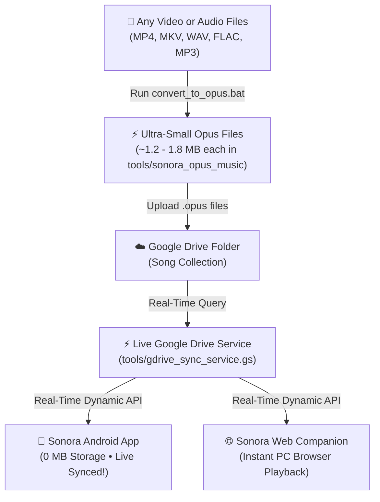

<div align="center">

# 🎵 SONORA
### Smart Cloud & Offline Music Player for Android (Redmi 12 5G & Web Companion)

[](https://github.com/DiptarkaSamanta/SONORA/actions/workflows/build-apk.yml)
[](https://github.com/DiptarkaSamanta/SONORA/releases/latest)
[](LICENSE)
[](https://github.com/DiptarkaSamanta/SONORA)
[](https://opus-codec.org/)
[-orange)](https://www.mi.com/)
[](https://github.com/DiptarkaSamanta/SONORA/releases/latest)

<p align="center">
  <b>Stream your Google Drive music library with 0 MB phone storage.</b><br>
  Real-time Opus 64kbps streaming, synchronized karaoke lyrics, 1-click batch conversion, and AMOLED glassmorphism UI.
</p>

[📥 Download Latest APK (3.28 MB)](https://github.com/DiptarkaSamanta/SONORA/releases/latest) • [🌐 Web Companion](sonora_browser_app.html) • [🛠️ Audio Converter](tools/convert_to_opus.bat)

---

</div>

## 🌟 Highlights

* **☁️ Zero Phone Storage Footprint (0 MB)**: Streams high-fidelity Opus 64kbps audio (~1.2 - 1.8 MB per song) directly from Google Drive / Cloud through memory buffers. Never consumes phone storage space.
* **🔄 Install Once, Auto-Sync Forever**: When you add new songs to Google Drive, your mobile app and web companion **automatically sync and stream all new songs in real time via the Live Google Drive API** — **no APK reinstallation or manual JSON editing needed!**
* **🎤 Synchronized Karaoke Lyrics**: Live line-by-line synchronized LRC lyrics powered by LRCLIB. Auto-scrolls smoothly to center the active line, with real-time glowing highlights and click-to-seek timestamp jumping.
* **⚡ High-Power Universal Converter**: Built-in 1-click batch converter (`tools/convert_to_opus.bat`) converts **any** video or audio format (`.mp4`, `.mkv`, `.webm`, `.flac`, `.wav`, `.mp3`, etc.) into ultra-compact Opus audio with video streams discarded.
* **🚀 Redmi 12 5G & HyperOS/MIUI Optimized**: Screen-off background playback, battery optimization bypass, zero CPU throttling, and RAM-friendly partial file hashing designed for Snapdragon 4 Gen 2.
* **🎨 AMOLED Glassmorphism UI**: Live theme color changer (Cyan, Purple, Pink, Green, Yellow), spinning vinyl disc full player, 5-band equalizer, bass boost, 3D virtualizer, sleep timer, and persistent mini-player with instant dismiss (`✕`).

---

## 📱 How Continuous Live Sync Works

You **only install the Sonora APK once**. Content changes and new songs apply automatically without reinstalling:



### 1. 100% Dynamic Song & Catalog Sync (No JSON Files)
- The app connects directly to the Live Google Drive Service (`tools/gdrive_sync_service.gs`) to query your folder in real time.
- Any songs added, renamed, or deleted in Google Drive appear dynamically on launch or pull-to-refresh.

### 2. App Code Updates (1-Click Notification)
- When native Kotlin/UI changes are pushed to GitHub, GitHub Actions compiles an updated release APK.
- The app includes a **Check Updates** button under **Cleaner & Maintenance** that detects new releases and lets you update with 1 tap.

---

## 🎧 Features

### 1. Audio Engine & Background Service
- **Android Media3 ExoPlayer**: Full `MediaSessionService` implementation with foreground notification, lock screen controls, and album artwork.
- **Hardware Audio Effects**:
  - 5-band equalizer sliders (-12 dB to +12 dB).
  - Bass Boost and 3D Virtualizer.
  - Presets: Flat, Bass Boost, Rock, Pop, Jazz, EDM, Vocal, Acoustic.
- **Sleep Timer**: Smooth 15-second volume fade-out before playback stops (15m, 30m, 45m, 60m, or custom).
- **AudioFocus & Disconnect Protection**: Automatically pauses when Bluetooth headphones disconnect (`AUDIO_BECOMING_NOISY`).

### 2. Synchronized Karaoke Lyrics
- **Automatic Matching**: Strips track title modifiers (`(slowed reverb)`, `[official]`, `ft.`) for 100% LRCLIB query accuracy.
- **Interactive Karaoke**: Tap any lyric line to jump audio playback to that exact second.
- **Auto-Scroll**: Centers the current lyric smoothly as the music progresses.

### 3. Smart Storage & Cache Maintenance
- **Temp Cache Cleaner**: Frees network image cache and audio streaming buffers without deleting downloaded music.
- **Duplicate Audio Hash Detector**: Fast 64KB header MD5 fingerprinting identifies duplicate audio files across phone storage.
- **Instant Stop Button (`✕`)**: Stop playback and dismiss the player in 1 tap from the mini-player.

### 4. Live Theme Customizer
- Instant 1-tap color picker:
  - 🩵 **Electric Cyan** (Default)
  - 💜 **Cyber Purple**
  - 🩷 **Neon Pink**
  - 💚 **Emerald Green**
  - 💛 **Solar Amber**
- Recolor navigation, sliders, buttons, glows, and vinyl rings seamlessly.

---

## 🛠️ High-Power Universal Converter

Located in [`tools/`](tools/):

```
tools/
├── convert_to_opus.bat        # Single 1-Click Windows batch launcher
├── converter.py               # Universal batch conversion engine (FFmpeg)
├── gdrive_sync_service.gs     # Live real-time Google Drive sync service
└── sonora_opus_music/         # Converted .opus files ready for GDrive
```

### Quick Usage:
1. Double-click `convert_to_opus.bat` (or drag & drop your songs/videos directly onto it!).
2. Select **[1] Convert Songs**.
3. Paste one or multiple file/folder paths (e.g. `"C:\Music\song1.mp4" "D:\Downloads\video.mkv"`).
4. Files are converted into tiny Opus 64kbps files (~1.2 - 1.8 MB each) with video streams discarded.
5. Upload the converted `.opus` files to your Google Drive folder.
6. The converter prompts: `Have you uploaded these songs to Google Drive and want to delete local copies? (Y/N)` — press `Y` to wipe local copies and keep your computer storage clean!

---

## 📱 Redmi 12 5G & HyperOS Optimizations

The Redmi 12 5G features a Qualcomm Snapdragon 4 Gen 2 processor with MIUI / HyperOS aggressive battery management. Sonora includes:

1. **Direct Settings Dispatcher**:
   - `XiaomiOptimizationHelper.openBatterySaverSettings()`: Launches MIUI HiddenAppsConfig screen to select **No restrictions**.
   - `XiaomiOptimizationHelper.openAutostartSettings()`: Directly opens MIUI Autostart manager so playback never stops when the screen is locked.
2. **Foreground Service Configuration**:
   - Uses `foregroundServiceType="mediaPlayback"` with wake locks to prevent CPU sleeping during audio decoding.
3. **Low-RAM Footprint**:
   - Streams audio buffers progressively to prevent OOM on 4GB/6GB RAM models.

---

## 🏗️ Project Architecture

```
com.sonora.music
├── core
│   ├── database/          # Room DB (SonoraDatabase, SongEntity, SongDao)
│   ├── datastore/         # DataStore preferences
│   ├── di/                # ServiceLocator dependency injection
│   └── network/           # CloudDatabaseClient, Retrofit, OkHttp, LRCLIB API
├── domain
│   ├── model/             # Song, StorageMode, LyricsData, EqualizerPreset
│   └── repository/        # Domain repository interfaces
├── data
│   ├── download/          # WorkManager background download worker
│   ├── repository/        # MusicRepositoryImpl, StorageRepositoryImpl
│   ├── scanner/           # Scoped MediaStore audio scanner
│   └── storage/           # StorageOptimizer & DuplicateDetector heuristics
├── playback
│   ├── AudioEffectsController.kt # Equalizer, Bass Boost, 3D Virtualizer
│   ├── PlaybackManager.kt        # Media3 ExoPlayer orchestration & AudioFocus
│   ├── SleepTimerManager.kt      # Smooth fade-out sleep timer
│   └── SonoraMediaService.kt     # MediaSessionService & Foreground playback
├── xiaomi
│   └── XiaomiOptimizationHelper.kt # MIUI / HyperOS battery & autostart dispatchers
└── ui
    ├── components/        # MiniPlayer (with instant stop ✕), SongItem, GlassmorphicCard
    ├── navigation/        # Bottom navigation bar & full player modal
    ├── screens/           # Home, Search, Library, Downloads, Storage, Full Player
    └── theme/             # AMOLED-friendly palette (Black, Purple, Electric Blue, Magenta)
```

---

## 🚀 Building from Source

### Prerequisites
- Android Studio Ladybug (2024.2+) or Hedgehog+
- JDK 17 (Eclipse Temurin recommended)
- Android SDK Platform 34 (Android 14)

### Build Commands:
```bash
# Clone the repository
git clone https://github.com/DiptarkaSamanta/SONORA.git
cd SONORA

# Build ultra-compact release APK
./gradlew assembleRelease

# Output APK location:
# app/build/outputs/apk/release/Sonora-v1.0.0-Redmi12-5G.apk
```

---

## 📄 License

This project is open-source and licensed under the **[MIT License](LICENSE)**.

Copyright (c) 2026 **Diptarka Samanta**.
